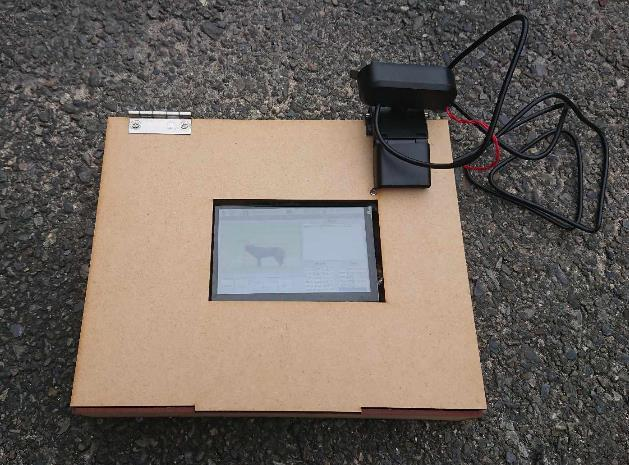
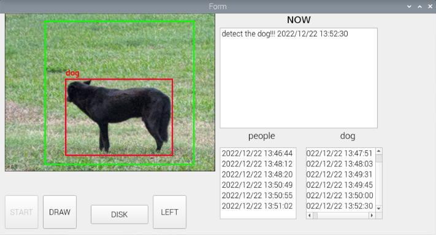
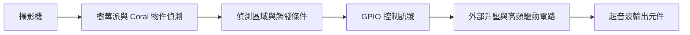
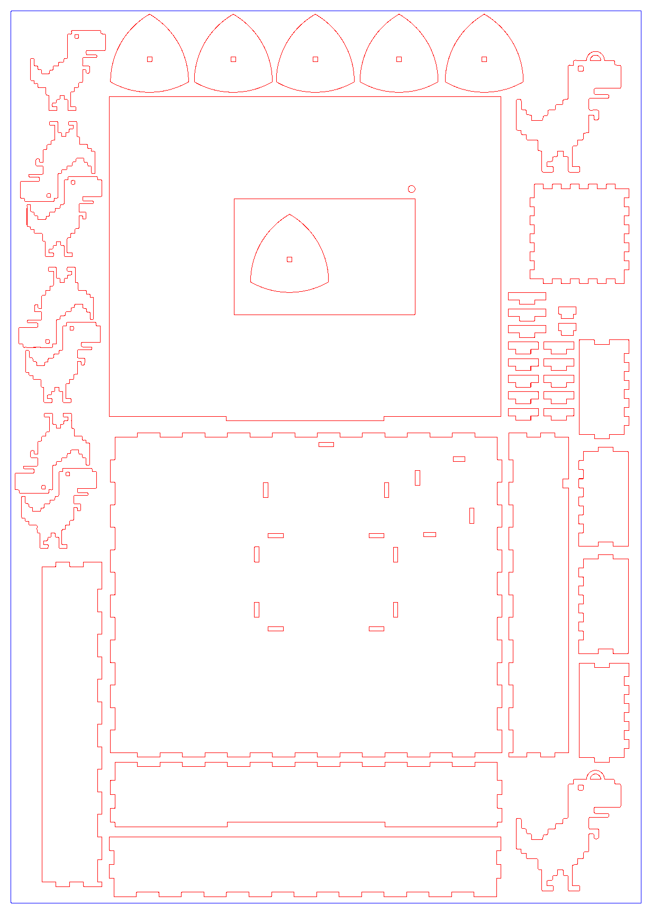
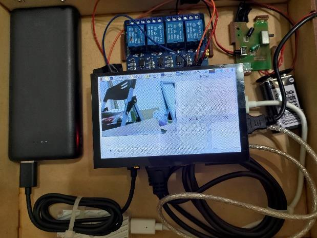

# 智能驅狗器

智能驅狗器是一套結合影像物件偵測與超音波輸出的原型裝置，目標是在指定區域內偵測犬隻，並依現場是否有人、犬隻停留時間等條件，決定是否驅離。

系統以 Raspberry Pi 4 為運算平台，搭配 Coral 加速器、攝影機與 7 吋觸控螢幕。使用者可在畫面上設定偵測範圍；依系統設計，當狗進入範圍、畫面中沒有人且停留超過設定時間後，透過 GPIO 控制外部升壓與高頻驅動電路，啟動超音波輸出，直到狗離開範圍。

## 運作原理

系統設計流程如下：

1. **啟動與載入**：開啟圖形介面與物件偵測模型，取得攝影機畫面。
2. **設定範圍**：使用者框選需要監測的區域，限制觸發條件的判斷範圍。
3. **辨識目標**：取得人與狗的類別、分數及位置框，判斷狗是否進入設定區域。
4. **檢查人員與停留時間**：畫面中有人時不啟動驅離；狗在範圍內停留超過 10 秒且畫面沒有人時，觸發輸出。
5. **驅動與停止**：樹莓派輸出 GPIO 控制訊號，由外部電路升壓並產生高頻驅動訊號；狗離開設定區域後停止輸出。
6. **顯示紀錄**：介面顯示偵測畫面及相關紀錄，供查看出現時間與系統狀態。

人員是否出現是控制條件之一，並不能單靠這個條件辨認犬隻是否有飼主。

## 操作介面

PyQt5 介面整合攝影機畫面、範圍設定與偵測紀錄。下圖可看到綠色監測範圍、紅色物件位置框，以及右側的人／狗紀錄欄。

## 系統架構

| 模組 | 使用技術與用途 |
| --- | --- |
| 運算平台 | Raspberry Pi 4、Coral 加速器 |
| 影像輸入 | Webcam、OpenCV |
| 物件偵測 | PyCoral、TensorFlow Lite；模型檔名為 EfficientDet |
| 操作介面 | 7 吋觸控螢幕、PyQt5 |
| 輸出控制 | GPIO 訊號、外部升壓與高頻驅動電路 |
| 外殼 | Illustrator 2D 繪圖、雷射切割板件 |

## 硬體與外殼

裝置以雷射切割板件製作外殼，整合觸控螢幕、樹莓派、Coral 加速器、電源與驅動電路，透過板件開孔及內部配置安排元件與線路。樹莓派以行動電源供電，超音波驅動電路採獨立供電。

| 雷切圖面 | 內部配置 |
| --- | --- |
|  |  |

[外殼圖檔與照片](hardware/enclosure/)

## 專案內容

| 目錄 | 內容 |
| --- | --- |
| [hardware/enclosure](hardware/enclosure/) | Illustrator 原始圖與圖面預覽 |
| [software/inference](software/inference/) | 攝影機物件偵測程式、模型與標籤 |
| [software/integration](software/integration/) | 區域判斷、計時與觸發邏輯的開發程式 |
| [dataset](dataset/) | 目前找回的 404 張 640×480 影像與縮圖程式；無法確認是否用於最終版本 |

## 程式與資料狀態

上述說明呈現原型的系統設計與成品。本專案已收錄目前能找到的程式與資料，包含模型推論及部分整合邏輯。由於部分原始檔案目前已無法找回，完整 PyQt5 介面、GPIO 控制程式、模型訓練流程與影像標註無法一併提供，因此尚不能直接重現整套系統。

資料集也處於缺失、不完整的狀態。此處的 404 張影像是目前能找回的部分，無法確認是否曾用於最終版本的模型訓練，也不能視為當時完整的訓練資料集。

相關工具與參考連結見 [THIRD_PARTY.md](THIRD_PARTY.md)。
"# intelligent_dog_deterrent" 
